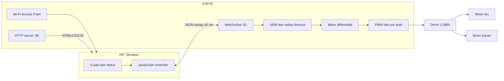
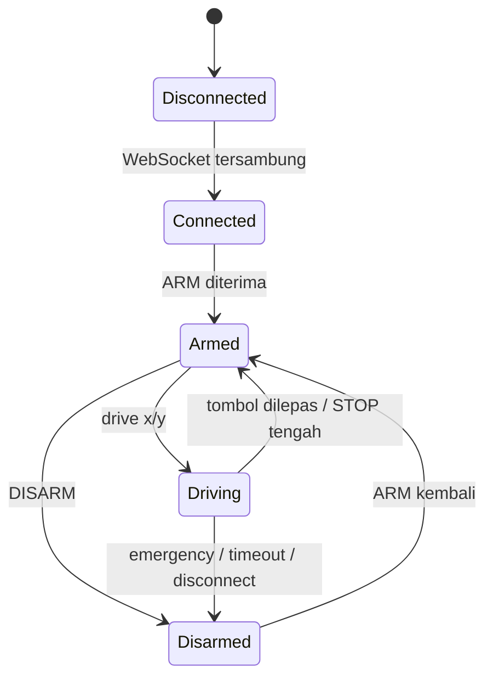
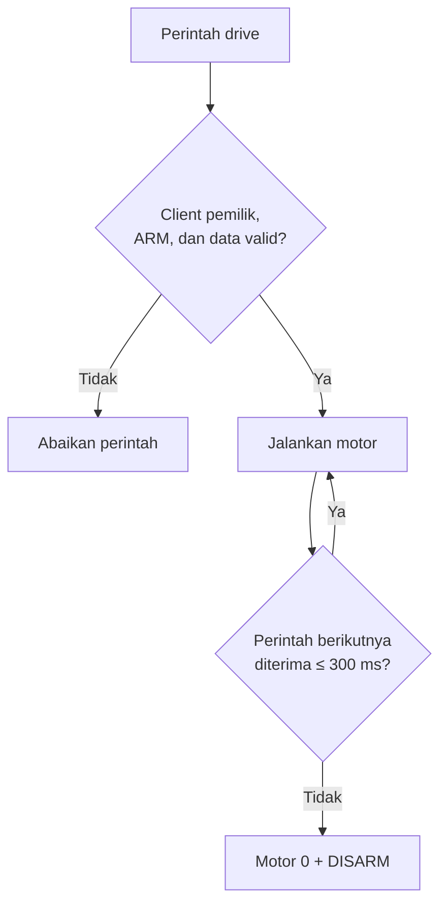

<div align="center">

# ⚽ ESP32 Soccer Robot Web Controller

[](https://www.espressif.com/en/products/socs/esp32)
[](https://platformio.org/)
[](https://www.arduino.cc/)
[](#-arsitektur-sistem)

**Robot A:** hitam–pink &nbsp;·&nbsp; **Robot B:** hitam–biru

</div>

---

## 📑 Daftar isi

- [Gambaran umum](#-gambaran-umum)
- [Quick start](#-quick-start)
- [Konfigurasi dua robot](#-konfigurasi-dua-robot)
- [Kebutuhan](#-kebutuhan)
- [Wiring ESP32 dan L298N](#-wiring-esp32-dan-l298n)
- [Instalasi, build, dan upload](#-instalasi-build-dan-upload)
- [Cara menggunakan controller](#-cara-menggunakan-controller)
- [Kontrol arah dan motor mixing](#-kontrol-arah-dan-motor-mixing)
- [Arsitektur sistem](#-arsitektur-sistem)
- [Protokol WebSocket](#-protokol-websocket)
- [Sistem keselamatan](#-sistem-keselamatan)
- [Serial Monitor dan debugging](#-serial-monitor-dan-debugging)
- [Kustomisasi](#%EF%B8%8F-kustomisasi)
- [Troubleshooting](#-troubleshooting)

## ✨ Gambaran umum

Project ini menyediakan satu codebase untuk dua unit soccer robot. Identitas, Wi-Fi, dan warna controller dipilih saat compile melalui environment PlatformIO.

### Fitur

- 📡 ESP32 bekerja sebagai Wi-Fi Access Point mandiri.
- 🌐 Controller berjalan langsung di browser HP.
- 🎮 D-pad delapan arah dengan dukungan pointer/touch.
- ⚡ WebSocket untuk respons kontrol real-time.
- 🤖 Firmware terpisah untuk Robot A dan Robot B dari source yang sama.
- 🎨 Tema hitam–pink untuk A dan hitam–biru untuk B.
- 🔐 Sistem ARM/DISARM dan kepemilikan controller.
- 🛑 STOP biasa dan EMERGENCY STOP.
- 📊 Telemetri X, Y, motor kiri, dan motor kanan.
- 📱 Mode landscape serta tombol fullscreen.
- 🔁 Reconnect WebSocket otomatis.
- 🧯 Timeout dan penghentian otomatis ketika koneksi terputus.
- 🧪 Log Serial untuk koneksi, tombol, dan output motor.

### Cara kerja singkat

```text
HP ──Wi-Fi──> ESP32 ──PWM + arah──> L298N ──> Motor kiri/kanan
       │
       ├── HTTP :80      halaman controller
       └── WebSocket :81 perintah dan telemetri
```

## 🚀 Quick start

> Pastikan wiring dan suplai motor sudah benar sebelum menekan ARM.

1. Hubungkan ESP32 ke komputer menggunakan kabel USB data.
2. Upload environment yang sesuai:

   ```powershell
   # Robot A
   pio run -e robot_a -t upload

   # Robot B
   pio run -e robot_b -t upload
   ```

3. Nyalakan robot.
4. Hubungkan HP ke `SOCCER-BOT-01` atau `SOCCER-BOT-02`.
5. Gunakan password `robot12345`.
6. Buka `http://192.168.4.1`.
7. Putar HP ke landscape, tekan **ARM ROBOT**, lalu gunakan tombol arah.

## 🤖 Konfigurasi dua robot

| Parameter | Robot A | Robot B |
|---|---|---|
| Environment | `robot_a` | `robot_b` |
| `ROBOT_ID` | `1` | `2` |
| Nama perangkat | `ROBOT A` | `ROBOT B` |
| SSID | `SOCCER-BOT-01` | `SOCCER-BOT-02` |
| Password | `robot12345` | `robot12345` |
| Channel Wi-Fi | `1` | `6` |
| Tema web | Hitam–pink | Hitam–biru |
| URL controller | `http://192.168.4.1` | `http://192.168.4.1` |

Alamat IP keduanya sama karena setiap robot membuat jaringan yang terpisah. Satu HP hanya dapat terhubung ke satu jaringan robot pada satu waktu. Gunakan dua HP jika kedua robot ingin dikendalikan bersamaan.

## 🧰 Kebutuhan

### Hardware per robot

| Komponen | Jumlah | Catatan |
|---|---:|---|
| ESP32 DOIT DevKit V1 | 1 | Controller utama |
| Driver motor L298N | 1 | Dual H-bridge |
| Motor DC | 2 | Motor kiri dan kanan |
| Sumber daya motor | 1 | Sesuaikan tegangan motor |
| Kabel USB data | 1 | Upload dan debug |
| Kabel jumper | Sesuai kebutuhan | Gunakan koneksi yang kokoh |
| HP dengan browser modern | 1 | Controller robot |

### Software

- Visual Studio Code
- Extension PlatformIO IDE
- Platform `espressif32`
- Framework Arduino

### Library

Library dikelola otomatis melalui `platformio.ini`:

| Library | Fungsi |
|---|---|
| `links2004/WebSockets` | Server WebSocket pada port 81 |
| `bblanchon/ArduinoJson` | Parsing dan serialisasi pesan JSON |
| `WebServer` | HTTP server halaman controller |
| `WiFi` | Access Point ESP32 |

## 📁 Struktur project

```text
esp32-web-controller/
├── platformio.ini          # Board, library, dan environment A/B
├── README.md               # Dokumentasi project
└── src/
    ├── main.cpp            # Motor, Wi-Fi, HTTP, WebSocket, dan safety
    └── controller_html.h   # HTML, CSS, JavaScript, dan tema A/B
```

## 🔌 Wiring ESP32 dan L298N

### Pin default

| Sisi | Fungsi | GPIO ESP32 | L298N |
|---|---|---:|---|
| Kiri / channel A | PWM | `14` | `ENA` |
| Kiri / channel A | Arah 1 | `26` | `IN1` |
| Kiri / channel A | Arah 2 | `27` | `IN2` |
| Kanan / channel B | PWM | `33` | `ENB` |
| Kanan / channel B | Arah 1 | `18` | `IN3` |
| Kanan / channel B | Arah 2 | `19` | `IN4` |
| Bersama | Ground | `GND` | `GND` |

```text
ESP32                         L298N
┌──────────┐               ┌──────────────┐
│ GPIO 14  ├──────────────>│ ENA          │
│ GPIO 26  ├──────────────>│ IN1     OUT1 ├──┐
│ GPIO 27  ├──────────────>│ IN2     OUT2 ├──┴─ Motor kiri
│ GPIO 33  ├──────────────>│ ENB          │
│ GPIO 18  ├──────────────>│ IN3     OUT3 ├──┐
│ GPIO 19  ├──────────────>│ IN4     OUT4 ├──┴─ Motor kanan
│ GND      ├──────────────>│ GND          │
└──────────┘               └──────────────┘
                                  ▲
                                  └── sumber daya motor
```

> [!WARNING]
> Jangan memberi daya motor dari pin 3,3 V ESP32. Gunakan sumber daya motor yang sesuai dan **satukan GND ESP32 dengan GND L298N**.

### ENA dan ENB

Firmware menggunakan ENA dan ENB sebagai input PWM:

- `ENA` dikendalikan GPIO 14.
- `ENB` dikendalikan GPIO 33.
- Frekuensi PWM: `20 kHz`.
- Resolusi: `8 bit`.
- Rentang PWM: `0–255`.
- Batas daya saat ini: `100%`.

> [!CAUTION]
> Lepas jumper ENA/ENB jika pin tersebut dihubungkan ke output ESP32. Jangan membiarkan jumper 5 V terpasang pada pin yang juga terhubung ke GPIO ESP32.

## 🛠 Instalasi, build, dan upload

### Membuka project

1. Install Visual Studio Code dan PlatformIO IDE.
2. Buka folder `esp32-web-controller`.
3. Tunggu PlatformIO menyelesaikan instalasi dependency.

### Build

```powershell
# Build Robot A
pio run -e robot_a

# Build Robot B
pio run -e robot_b

# Build keduanya
pio run -e robot_a -e robot_b
```

Environment default adalah `robot_a`. Selalu pilih `robot_b` secara eksplisit saat memprogram Robot B.

### Menemukan port ESP32

```powershell
pio device list
```

Cara sederhana memastikan port yang benar: catat daftar port, cabut ESP32, lalu lihat port mana yang hilang.

### Upload melalui terminal

```powershell
# Ganti COM5 dengan port ESP32 yang benar
pio run -e robot_a -t upload --upload-port COM5
pio run -e robot_b -t upload --upload-port COM5
```

Tanpa menentukan port secara manual:

```powershell
pio run -e robot_b -t upload
```

### Upload melalui antarmuka VS Code

1. Buka ikon **PlatformIO** di sidebar.
2. Pilih **PROJECT TASKS**.
3. Buka environment `robot_a` atau `robot_b`.
4. Buka **General**.
5. Klik **Upload**.

## 🎮 Cara menggunakan controller

1. Nyalakan ESP32 dan suplai motor.
2. Hubungkan HP ke SSID robot.
3. Masukkan password `robot12345`.
4. Abaikan peringatan *Wi-Fi tidak memiliki internet*.
5. Buka `http://192.168.4.1` menggunakan HTTP, bukan HTTPS.
6. Pastikan indikator menampilkan **CONNECTED**.
7. Putar HP ke posisi horizontal.
8. Tekan **FULL** untuk fullscreen jika didukung browser.
9. Tekan **ARM ROBOT**.
10. Tekan dan tahan panah untuk bergerak; lepaskan untuk berhenti.

### Arti tombol dan indikator

| Elemen | Fungsi |
|---|---|
| `CONNECTED` | WebSocket antara browser dan robot aktif |
| `ARMED` | Robot siap menerima perintah gerak |
| `DISARMED` | Perintah gerak dinonaktifkan |
| `BUSY` | Robot sedang dikendalikan client lain |
| `TIMEOUT` | Perintah terputus lebih dari batas keselamatan |
| `ARM ROBOT` | Mengambil hak kontrol dan mengaktifkan robot |
| `DISARM ROBOT` | Menghentikan motor dan melepas hak kontrol |
| Panah | Menggerakkan robot selama tombol ditahan |
| `STOP` tengah | Berhenti tanpa melepas ARM |
| `EMERGENCY STOP` | Berhenti dan langsung DISARM |
| `FULL` | Fullscreen dan mencoba mengunci landscape |

## 🧭 Kontrol arah dan motor mixing

Controller mengirim koordinat `x` dan `y` pada rentang `-100` hingga `100`.

| Gerakan | X | Y | PWM kiri | PWM kanan |
|---|---:|---:|---:|---:|
| ↖ Maju kiri | -30 | 100 | 137 | 255 |
| ↑ Maju | 0 | 100 | 255 | 255 |
| ↗ Maju kanan | 30 | 100 | 255 | 137 |
| ← Putar kiri | -100 | 0 | -255 | 255 |
| ■ Berhenti | 0 | 0 | 0 | 0 |
| → Putar kanan | 100 | 0 | 255 | -255 |
| ↙ Mundur kiri | -30 | -100 | -255 | -137 |
| ↓ Mundur | 0 | -100 | -255 | -255 |
| ↘ Mundur kanan | 30 | -100 | -137 | -255 |

Rumus differential drive:

```text
motor kiri  = y + x
motor kanan = y - x
```

Hasil dinormalisasi ke rentang `-255..255`. Nilai negatif berarti motor berputar ke arah sebaliknya.

> [!NOTE]
> Pada gerakan diagonal, satu motor memang bergerak lebih lambat. Jika hanya satu motor terpasang, beberapa tombol dapat terlihat tidak merespons karena output dominan sedang diberikan ke motor yang belum dipasang.

## 🏗 Arsitektur sistem



### Alur status robot



## 📨 Protokol WebSocket

### Client → ESP32

```json
{"type":"arm"}
```

```json
{"type":"drive","x":0,"y":100}
```

```json
{"type":"disarm"}
```

```json
{"type":"stop"}
```

### ESP32 → client

```json
{
  "type": "status",
  "robot": "ROBOT A",
  "armed": true,
  "left": 255,
  "right": 255,
  "message": "DRIVING"
}
```

| Message | Arti |
|---|---|
| `CONNECTED` | WebSocket baru terhubung |
| `ARMED` | Client berhasil mengambil kontrol |
| `DRIVING` | Motor sedang menerima perintah |
| `DISARMED` | Robot dinonaktifkan secara normal |
| `STOPPED` | Emergency stop dijalankan |
| `BUSY` | Robot dimiliki client lain |
| `TIMEOUT` | Perintah drive terlambat lebih dari 300 ms |

## 🛡 Sistem keselamatan



- Perintah drive hanya diterima setelah ARM.
- Hanya client pemilik ARM yang dapat menggerakkan robot.
- Emergency stop dapat dikirim oleh client mana pun.
- Motor berhenti ketika controller pemilik terputus.
- Timeout `300 ms` menghentikan motor dan melakukan DISARM.
- Browser melakukan DISARM saat halaman disembunyikan.
- Browser mengirim emergency stop saat halaman ditinggalkan.
- Perubahan ke orientasi portrait memicu DISARM.
- Nilai X/Y wajib berupa integer dalam rentang `-100..100`.
- Payload kosong atau lebih dari 256 byte diabaikan.
- PWM dibuat nol sebelum polaritas H-bridge diubah.

> [!IMPORTANT]
> Pengaman perangkat lunak bukan pengganti sakelar darurat fisik. Pasang sakelar daya motor yang mudah dijangkau.

## 🧪 Serial Monitor dan debugging

Baud rate: `115200`.

```powershell
pio device monitor -b 115200
```

Contoh startup Robot B:

```text
================================
ROBOT B
Wi-Fi: READY
SSID: SOCCER-BOT-02
URL: http://192.168.4.1
WebSocket: port 81
================================
SYSTEM READY
```

| Prefix log | Informasi |
|---|---|
| `[HTTP]` | Halaman controller diminta |
| `[WS]` | Client terhubung atau terputus |
| `[RX]` | Perintah non-drive diterima |
| `[CMD]` | ARM, DISARM, dan STOP |
| `[DRIVE]` | Arah dan hasil PWM motor |
| `[SAFETY]` | Motor dihentikan oleh pengaman |
| `[DEBUG]` | Pembersihan state internal |

```text
[DRIVE] Client #0 x=-30 y=100 power=100% -> L=137 R=255
```

Tutup Serial Monitor sebelum upload karena port COM hanya dapat diakses satu proses dalam satu waktu.

## ⚙️ Kustomisasi

### Mengubah pin motor

Edit namespace `Config` di `src/main.cpp`:

```cpp
constexpr uint8_t PIN_ENA = 14;
constexpr uint8_t PIN_IN1 = 26;
constexpr uint8_t PIN_IN2 = 27;
constexpr uint8_t PIN_ENB = 33;
constexpr uint8_t PIN_IN3 = 18;
constexpr uint8_t PIN_IN4 = 19;
```

### Membalik arah motor

```cpp
constexpr int8_t LEFT_DIRECTION = 1;
constexpr int8_t RIGHT_DIRECTION = -1; // contoh: balik motor kanan
```

Pilihan lain adalah menukar kabel output motor pada sisi tersebut. Matikan daya motor sebelum mengubah wiring.

### Mengubah batas kecepatan

```cpp
constexpr uint8_t DRIVE_SPEED_PERCENT = 100;
```

Gunakan nilai `0–100`. Controller saat ini tidak memiliki slider; batas kecepatan ditetapkan saat compile.

### Mengubah Wi-Fi

Konfigurasi tiap robot berada dalam blok berikut di `src/main.cpp`:

```cpp
#if ROBOT_ID == 1
// Robot A
#else
// Robot B
#endif
```

Password Wi-Fi ESP32 harus terdiri dari minimal delapan karakter. Upload ulang firmware setelah perubahan.

### Mengubah tema

Palet disusun berdasarkan `ROBOT_ID` di `src/controller_html.h`:

- `ROBOT_ID=1` → tema hitam–pink.
- `ROBOT_ID=2` → tema hitam–biru.

```ini
[env:robot_a]
build_flags =
    -D ROBOT_ID=1

[env:robot_b]
build_flags =
    -D ROBOT_ID=2
```

Karena halaman web disimpan di flash ESP32, perubahan tampilan memerlukan upload firmware ulang.

## 🔧 Troubleshooting

<details>
<summary><strong>Upload gagal: port COM busy atau access denied</strong></summary>

```text
Could not open COM5, the port is busy or doesn't exist
PermissionError(13, 'Access is denied.')
```

1. Tutup Serial Monitor.
2. Hentikan proses upload lain dengan `Ctrl+C`.
3. Tutup Arduino IDE atau terminal serial lain.
4. Cabut dan pasang kembali kabel USB.
5. Jalankan `pio device list` untuk mencari port yang benar.
6. Jika masih gagal, tutup lalu buka kembali VS Code.

</details>

<details>
<summary><strong>Wi-Fi robot tidak muncul</strong></summary>

- Pastikan upload firmware berhasil.
- Buka Serial Monitor pada 115200 baud.
- Periksa apakah log menunjukkan `Wi-Fi: READY`.
- Periksa suplai ESP32 dan kabel USB.
- Tekan tombol reset ESP32.
- Pastikan environment firmware sesuai robot.

</details>

<details>
<summary><strong>Wi-Fi terhubung tetapi controller tidak terbuka</strong></summary>

- Buka `http://192.168.4.1`, bukan HTTPS.
- Pastikan HP terhubung ke SSID robot yang benar.
- Abaikan notifikasi jaringan tanpa internet.
- Nonaktifkan sementara data seluler atau fitur auto-switch jaringan.
- Refresh halaman atau bersihkan cache browser.

</details>

<details>
<summary><strong>Status CONNECTED tetapi motor diam</strong></summary>

1. Pastikan sudah menekan **ARM ROBOT**.
2. Lihat nilai `MOTOR L` dan `MOTOR R` pada controller.
3. Lihat log `[DRIVE]` pada Serial Monitor.
4. Periksa ENA, ENB, IN1–IN4, dan ground bersama.
5. Pastikan sumber daya motor aktif.
6. Pastikan jumper ENA/ENB dilepas jika GPIO PWM digunakan.
7. Uji kedua motor dan kedua channel L298N secara terpisah.

Jika nilai PWM berubah tetapi motor diam, masalah kemungkinan berada pada wiring, driver, suplai, atau motor—bukan komunikasi web.

</details>

<details>
<summary><strong>Arah motor terbalik</strong></summary>

- Ubah `LEFT_DIRECTION` atau `RIGHT_DIRECTION` menjadi `-1`.
- Atau tukar dua kabel motor pada sisi yang salah.
- Matikan daya motor sebelum memindahkan kabel.

</details>

<details>
<summary><strong>Robot langsung TIMEOUT atau DISARM</strong></summary>

- Pastikan koneksi WebSocket stabil.
- Jangan berpindah aplikasi atau mengunci layar saat mengontrol.
- Pastikan HP tidak meninggalkan Wi-Fi robot.
- Gunakan controller dalam landscape.
- Browser sengaja melakukan DISARM ketika halaman tersembunyi atau orientasi berubah ke portrait.

</details>

<details>
<summary><strong>Fullscreen atau orientation lock tidak bekerja</strong></summary>

Fitur ini bergantung pada browser dan sistem operasi. Beberapa browser hanya mengizinkan fullscreen setelah tombol ditekan dan dapat menolak penguncian orientasi. Putar HP secara manual ke landscape jika diperlukan.

</details>

## 📌 Catatan operasional

- Access Point menerima maksimum dua client.
- Hanya satu client dapat memiliki kontrol aktif.
- Robot A dan B memakai channel berbeda untuk mengurangi interferensi.
- Gunakan sakelar fisik untuk memutus suplai motor dalam keadaan darurat.
- Lakukan pengujian pertama dengan roda tidak menyentuh lantai.
- Jangan melakukan wiring ulang ketika suplai motor aktif.

---

<div align="center">

**Build environment:** `robot_a` ✅ &nbsp;·&nbsp; `robot_b` ✅

Board: `esp32doit-devkit-v1` &nbsp;·&nbsp; Framework: Arduino &nbsp;·&nbsp; Baud: `115200`

</div>
