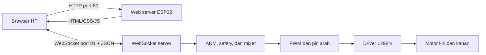

# ESP32 Web Controller untuk Soccer Robot

Project ini adalah sistem kendali dua robot berbasis **ESP32** melalui halaman web lokal. ESP32 membuat Wi-Fi Access Point sendiri, menyajikan halaman controller melalui HTTP, lalu menerima perintah arah secara real-time melalui WebSocket.

Satu source code digunakan untuk dua robot:

| Robot | Environment PlatformIO | SSID | Password | Channel | Tema controller |
|---|---|---|---|---:|---|
| Robot A | `robot_a` | `SOCCER-BOT-01` | `robot12345` | 1 | Hitam–pink |
| Robot B | `robot_b` | `SOCCER-BOT-02` | `robot12345` | 6 | Hitam–biru |

Controller dapat dibuka dari HP tanpa router dan tanpa koneksi internet.

## Fitur utama

- ESP32 bekerja sebagai Wi-Fi Access Point mandiri.
- Halaman controller tersimpan langsung di flash ESP32.
- Kontrol delapan arah dengan tampilan D-pad.
- Mendukung maju, mundur, berputar, dan bergerak diagonal.
- Komunikasi real-time menggunakan WebSocket.
- Kecepatan motor ditetapkan pada daya maksimum.
- Tombol ARM/DISARM untuk mencegah motor aktif tanpa sengaja.
- Tombol STOP tengah untuk menghentikan gerakan tanpa melepas status ARM.
- Tombol EMERGENCY STOP untuk menghentikan motor dan melakukan DISARM.
- Indikator koneksi dan status ARM ditampilkan secara terpisah.
- Telemetri nilai X, Y, PWM motor kiri, dan PWM motor kanan.
- Tampilan horizontal dan dukungan fullscreen pada browser yang kompatibel.
- Tema berbeda otomatis untuk Robot A dan Robot B.
- Debug koneksi dan perintah tersedia melalui Serial Monitor.
- Pengaman timeout, disconnect, pergantian halaman, dan perubahan orientasi.
- Hanya satu client yang dapat menjadi controller aktif pada satu waktu.

## Kebutuhan

### Hardware

- 1× ESP32 DOIT DevKit V1 untuk setiap robot.
- 1× driver motor L298N untuk setiap robot.
- 2× motor DC untuk setiap robot.
- Baterai atau sumber daya motor yang sesuai.
- Kabel jumper.
- Kabel USB data untuk upload firmware.
- HP dengan browser modern.

### Software

- [Visual Studio Code](https://code.visualstudio.com/)
- Extension PlatformIO IDE
- Platform Espressif32
- Framework Arduino

Library akan dipasang otomatis oleh PlatformIO:

- `links2004/WebSockets`
- `bblanchon/ArduinoJson`
- `WebServer` bawaan ESP32 Arduino Core
- `WiFi` bawaan ESP32 Arduino Core

## Struktur project

```text
esp32-web-controller/
├── platformio.ini          # Environment Robot A dan Robot B
├── README.md               # Dokumentasi project
└── src/
    ├── main.cpp            # Wi-Fi, server, WebSocket, motor, dan safety
    └── controller_html.h   # HTML, CSS, dan JavaScript controller
```

## Wiring ESP32 ke L298N

Konfigurasi pin default berada pada `src/main.cpp`.

| Fungsi | Pin ESP32 | Pin L298N | Keterangan |
|---|---:|---|---|
| PWM motor kiri | GPIO 14 | ENA | Mengatur daya motor channel A |
| Arah motor kiri 1 | GPIO 26 | IN1 | Arah channel A |
| Arah motor kiri 2 | GPIO 27 | IN2 | Arah channel A |
| PWM motor kanan | GPIO 33 | ENB | Mengatur daya motor channel B |
| Arah motor kanan 1 | GPIO 18 | IN3 | Arah channel B |
| Arah motor kanan 2 | GPIO 19 | IN4 | Arah channel B |
| Ground | GND | GND | Ground harus disatukan |

Sambungan motor:

- Motor kiri ke `OUT1` dan `OUT2`.
- Motor kanan ke `OUT3` dan `OUT4`.
- Sumber daya motor masuk ke terminal power L298N sesuai tegangan motor.

> **Penting:** jangan memberi daya motor dari pin 3,3 V ESP32. Gunakan sumber daya motor yang sesuai dan satukan GND ESP32 dengan GND L298N.

### Penggunaan ENA dan ENB

ENA dan ENB digunakan sebagai input PWM oleh firmware. Jika ENA terhubung ke GPIO 14 dan ENB ke GPIO 33, lepas jumper ENA/ENB pada modul L298N. Jangan membiarkan jumper 5 V terpasang sambil menghubungkan pin yang sama ke output ESP32.

Konfigurasi PWM:

- Frekuensi: `20 kHz`
- Resolusi: `8 bit`
- Rentang output: `0–255`
- Daya maksimum: `100%`

## Instalasi project

1. Buka folder project di Visual Studio Code.
2. Pastikan extension PlatformIO IDE sudah terpasang.
3. Tunggu PlatformIO memasang platform dan library yang diperlukan.
4. Hubungkan ESP32 dengan kabel USB data.
5. Pilih environment sesuai robot yang akan diprogram.

## Build firmware

Build Robot A:

```powershell
pio run -e robot_a
```

Build Robot B:

```powershell
pio run -e robot_b
```

Build keduanya:

```powershell
pio run -e robot_a -e robot_b
```

Environment default pada `platformio.ini` adalah `robot_a`. Karena itu, selalu tuliskan `-e robot_b` atau pilih task `robot_b` saat memprogram Robot B.

## Upload firmware

### Melalui menu PlatformIO

1. Klik ikon PlatformIO pada sidebar VS Code.
2. Buka **PROJECT TASKS**.
3. Pilih `robot_a` atau `robot_b`.
4. Buka bagian **General**.
5. Klik **Upload**.

### Melalui terminal

Robot A:

```powershell
pio run -e robot_a -t upload --upload-port COM5
```

Robot B:

```powershell
pio run -e robot_b -t upload --upload-port COM5
```

Ganti `COM5` dengan port ESP32 yang digunakan. Daftar perangkat dapat diperiksa dengan:

```powershell
pio device list
```

PlatformIO juga dapat mencoba mendeteksi port secara otomatis:

```powershell
pio run -e robot_b -t upload
```

## Menjalankan controller

1. Nyalakan ESP32 dan driver motor.
2. Buka pengaturan Wi-Fi pada HP.
3. Hubungkan ke salah satu jaringan berikut:
   - `SOCCER-BOT-01` untuk Robot A.
   - `SOCCER-BOT-02` untuk Robot B.
4. Masukkan password `robot12345`.
5. Abaikan pemberitahuan bahwa jaringan tidak memiliki internet.
6. Buka browser dan akses:

```text
http://192.168.4.1
```

7. Putar HP ke posisi horizontal.
8. Tekan **FULL** jika ingin masuk ke mode fullscreen.
9. Pastikan status menunjukkan **CONNECTED**.
10. Tekan **ARM ROBOT**.
11. Tekan dan tahan tombol arah untuk menggerakkan robot.

## Fungsi tombol controller

| Tombol | Fungsi |
|---|---|
| `ARM ROBOT` | Memberikan hak kontrol kepada client dan mengaktifkan perintah motor |
| `DISARM ROBOT` | Menghentikan motor dan melepaskan hak kontrol |
| Panah | Menggerakkan robot selama tombol ditekan |
| `STOP` di tengah | Mengirim arah netral sehingga motor berhenti, tetapi robot tetap ARM |
| `EMERGENCY STOP` | Menghentikan motor dan langsung melakukan DISARM |
| `FULL` | Membuka fullscreen dan mencoba mengunci orientasi landscape |

## Pemetaan arah

Controller mengirim nilai `x` dan `y` dalam rentang `-100` sampai `100`.

| Gerakan | X | Y | Perkiraan PWM kiri | Perkiraan PWM kanan |
|---|---:|---:|---:|---:|
| Maju | 0 | 100 | 255 | 255 |
| Maju kiri | -30 | 100 | 137 | 255 |
| Maju kanan | 30 | 100 | 255 | 137 |
| Putar kiri | -100 | 0 | -255 | 255 |
| Berhenti | 0 | 0 | 0 | 0 |
| Putar kanan | 100 | 0 | 255 | -255 |
| Mundur kiri | -30 | -100 | -255 | -137 |
| Mundur | 0 | -100 | -255 | -255 |
| Mundur kanan | 30 | -100 | -137 | -255 |

Nilai negatif berarti arah motor dibalik. Firmware menggunakan differential drive mixing:

```text
motor kiri  = y + x
motor kanan = y - x
```

Hasil dinormalisasi agar tidak melebihi rentang PWM `-255` sampai `255`.

## Arsitektur komunikasi



- HTTP port `80` menyajikan halaman controller.
- WebSocket port `81` membawa perintah dan telemetri.
- Browser mengulangi perintah drive setiap `40 ms`.
- ESP32 menghentikan robot jika tidak menerima perintah selama lebih dari `300 ms`.

## Protokol WebSocket

Pesan dikirim dalam format JSON.

### Client ke ESP32

ARM:

```json
{"type":"arm"}
```

Drive:

```json
{"type":"drive","x":0,"y":100}
```

DISARM:

```json
{"type":"disarm"}
```

Emergency stop:

```json
{"type":"stop"}
```

### ESP32 ke client

Contoh status:

```json
{
  "type": "status",
  "robot": "ROBOT A",
  "armed": true,
  "left": 255,
  "right": 255,
  "message": "DRIVING"
}
```

Nilai `message` yang digunakan antara lain:

- `CONNECTED`
- `ARMED`
- `DRIVING`
- `DISARMED`
- `STOPPED`
- `BUSY`
- `TIMEOUT`

## Sistem keselamatan

Firmware dan halaman controller memiliki beberapa lapisan pengaman:

- Motor berhenti saat client pemilik WebSocket terputus.
- Motor berhenti dan robot DISARM jika command timeout lebih dari `300 ms`.
- Robot melakukan DISARM ketika halaman browser disembunyikan.
- Robot melakukan emergency stop ketika halaman ditutup atau ditinggalkan.
- Robot melakukan DISARM ketika HP kembali ke orientasi portrait.
- Perintah drive diabaikan jika robot belum ARM.
- Hanya client pemilik ARM yang dapat mengirim perintah drive.
- Emergency stop dapat digunakan oleh client mana pun.
- Payload WebSocket diabaikan jika kosong atau lebih dari 256 byte.
- Nilai drive divalidasi agar tetap berada pada rentang `-100` sampai `100`.

Pengaman perangkat lunak tidak menggantikan emergency switch fisik. Untuk robot kompetisi, gunakan sakelar daya motor yang mudah dijangkau.

## Serial Monitor dan debugging

Kecepatan Serial Monitor adalah `115200 baud`.

Melalui PlatformIO:

```powershell
pio device monitor -b 115200
```

Saat startup, ESP32 menampilkan identitas robot, status Wi-Fi, SSID, alamat controller, dan port WebSocket. Contoh:

```text
================================
ROBOT B
Wi-Fi: READY
SSID: SOCCER-BOT-02
URL: http://192.168.4.1
WebSocket: port 81
================================
SYSTEM READY
```

Prefix log yang umum:

| Prefix | Arti |
|---|---|
| `[HTTP]` | Browser meminta halaman controller |
| `[WS]` | Client WebSocket terhubung atau terputus |
| `[RX]` | ESP32 menerima perintah non-drive |
| `[CMD]` | ARM, DISARM, atau STOP diproses |
| `[DRIVE]` | Arah berubah dan nilai PWM dihitung |
| `[SAFETY]` | Motor dihentikan oleh mekanisme keselamatan |
| `[DEBUG]` | Pembersihan status internal, misalnya owner lama |

Tutup Serial Monitor sebelum upload karena port COM hanya dapat digunakan satu aplikasi pada satu waktu.

## Konfigurasi penting

Semua konfigurasi utama berada di namespace `Config` pada `src/main.cpp`.

### Mengubah pin motor

Ubah nilai berikut agar sesuai wiring:

```cpp
constexpr uint8_t PIN_ENA = 14;
constexpr uint8_t PIN_IN1 = 26;
constexpr uint8_t PIN_IN2 = 27;
constexpr uint8_t PIN_ENB = 33;
constexpr uint8_t PIN_IN3 = 18;
constexpr uint8_t PIN_IN4 = 19;
```

### Membalik arah motor

Jika salah satu sisi berputar terbalik, ubah faktor arah sisi tersebut dari `1` menjadi `-1`:

```cpp
constexpr int8_t LEFT_DIRECTION = 1;
constexpr int8_t RIGHT_DIRECTION = 1;
```

Contoh untuk membalik motor kanan:

```cpp
constexpr int8_t RIGHT_DIRECTION = -1;
```

Alternatifnya, tukar dua kabel output motor pada sisi yang terbalik. Jangan mengubah wiring saat daya motor masih aktif.

### Mengubah nama dan password Wi-Fi

Konfigurasi Robot A dan B dipisahkan menggunakan `ROBOT_ID`:

```cpp
#if ROBOT_ID == 1
// Robot A
#else
// Robot B
#endif
```

Password Access Point ESP32 minimal 8 karakter. Setelah mengubah konfigurasi, build dan upload ulang firmware robot yang bersangkutan.

### Mengubah kecepatan maksimum

Nilai saat ini adalah `100%`:

```cpp
constexpr uint8_t DRIVE_SPEED_PERCENT = 100;
```

Gunakan nilai `0–100`. Controller saat ini tidak menyediakan slider kecepatan; batas ini ditentukan saat firmware dikompilasi.

## Tema Robot A dan Robot B

Tema dipilih saat proses compile berdasarkan `ROBOT_ID` di `src/controller_html.h`:

- `ROBOT_ID=1`: aksen pink untuk Robot A.
- `ROBOT_ID=2`: aksen biru untuk Robot B.

Build flag ditentukan oleh `platformio.ini`:

```ini
[env:robot_a]
build_flags =
    -D ROBOT_ID=1

[env:robot_b]
build_flags =
    -D ROBOT_ID=2
```

Karena HTML disimpan di firmware, perubahan tampilan juga memerlukan upload ulang.

## Troubleshooting

### `Could not open COM5, the port is busy or doesn't exist`

- Tutup Serial Monitor.
- Hentikan proses upload lain dengan `Ctrl+C`.
- Tutup Arduino IDE atau aplikasi terminal serial lain.
- Cabut dan pasang kembali kabel USB.
- Periksa port menggunakan `pio device list`.
- Jika perlu, tutup lalu buka kembali VS Code.

### Wi-Fi robot tidak muncul

- Pastikan firmware berhasil di-upload.
- Buka Serial Monitor pada `115200 baud`.
- Pastikan log menunjukkan `Wi-Fi: READY`.
- Periksa kabel USB atau suplai daya ESP32.
- Tekan tombol reset ESP32.

### Browser terhubung ke Wi-Fi tetapi halaman tidak terbuka

- Buka langsung `http://192.168.4.1` dan pastikan menggunakan `http`, bukan `https`.
- Matikan sementara data seluler atau fitur yang otomatis meninggalkan Wi-Fi tanpa internet.
- Hapus cache halaman atau lakukan refresh.
- Pastikan HP terhubung ke SSID robot yang benar.

### Status CONNECTED tetapi motor tidak bergerak

- Tekan **ARM ROBOT** terlebih dahulu.
- Pastikan ENA dan ENB terhubung ke GPIO yang benar.
- Pastikan jumper ENA/ENB dilepas jika pin PWM ESP32 digunakan.
- Pastikan ground ESP32 dan L298N tersambung.
- Periksa sumber daya motor dan terminal output L298N.
- Lihat log `[DRIVE]` di Serial Monitor.
- Periksa nilai `L` dan `R`; jika nilainya berubah tetapi motor diam, masalah kemungkinan berada pada wiring, driver, suplai, atau motor.

### Hanya satu motor yang bergerak pada arah diagonal

Ini dapat terjadi sesuai hasil differential mixing. Pada beberapa arah, satu sisi bergerak lebih cepat daripada sisi lainnya. Jika hanya satu motor yang dipasang, beberapa tombol mungkin terlihat tidak merespons karena output dominan diberikan kepada sisi motor yang tidak terpasang.

### Robot langsung TIMEOUT setelah ARM

- Pastikan koneksi WebSocket stabil.
- Jangan pindah aplikasi atau mengunci layar saat mengontrol.
- Gunakan browser yang tetap menjalankan JavaScript saat halaman aktif.
- Pastikan HP tidak berpindah dari Wi-Fi robot ke jaringan lain.

### Tombol fullscreen atau orientation lock tidak bekerja

Fullscreen dan penguncian orientasi bergantung pada browser serta sistem operasi. Beberapa browser hanya mengizinkan fullscreen setelah interaksi pengguna dan dapat menolak orientation lock. Controller tetap dapat digunakan dengan memutar HP secara manual ke landscape.

## Catatan operasional

- Maksimum koneksi Wi-Fi dikonfigurasi sebanyak dua client.
- Satu robot hanya dapat dimiliki oleh satu controller aktif.
- Robot A dan Robot B berada pada channel Wi-Fi berbeda untuk mengurangi interferensi.
- Alamat `192.168.4.1` sama untuk kedua robot karena masing-masing membuat jaringan terpisah.
- HP hanya dapat terhubung ke satu Wi-Fi robot pada satu waktu.
- Gunakan satu HP/controller terpisah untuk setiap robot jika keduanya ingin dikendalikan bersamaan.

## Status project

Konfigurasi saat ini telah berhasil dikompilasi untuk environment `robot_a` dan `robot_b` menggunakan board `esp32doit-devkit-v1` dan framework Arduino.

